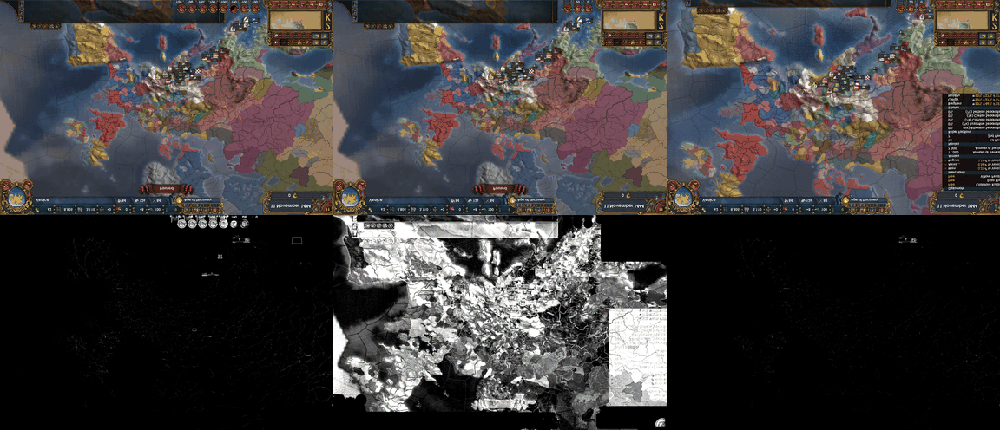

# M7.0 starter canary — trustworthy paused-gameplay frames

**Status: complete.** One bounded investigation, one minimal correction, **no new
EU4 launch**. The residual uncertainty is stated explicitly.

Question: *why can two authentic OpenGL EU4 processes fail to produce a
trustworthy aligned paused-gameplay frame pair even when the game-day identities
match?*

Top row: reference frames 74, 75 and 76 from session
`20261114T181230Z-d28f6fee`. Bottom row: amplified differences
(`|Δ| > 8`, dark = equal) for reference 74→75, reference 75→76, and
reference 74 vs candidate 74. The cross-process pair (bottom right) looks like a
subset of the same process's own frame-to-frame variation (bottom left), and
frame 76 is a visibly different HUD state (bottom middle).

## 1. Hypotheses

| ID | Hypothesis | Prediction |
| --- | --- | --- |
| H1 | The frames are **not actually comparable**: same day/identity, different render stage or a still-changing scene. | Consecutive frames from one process differ as much as, or more than, the cross-process pair; large changes occur at one game day. |
| H2 | The frames are comparable but differ because of **OpenGL/reference variability** (dither, multisample resolve, line rasterisation). | Differences are bounded and numeric, with no structural/content change; a static same-process pair would be stable. |
| H3 | The diagnostics **cannot distinguish** H1 from H2 with the available evidence. | The preserved evidence lacks the observation needed to separate content change from raster variation. |

The three findings the canary is required to separate map to: H1 →
finding 1, H2 → finding 2, H3 → finding 3.

## 2. Existing evidence reused

- `analysis/infra/experiments/2026-11-14-experiment-a.md` — the recorded
  Experiment A history (pause at a draw threshold, `game_speed_zero`, day-level
  identity, render-stage mismatches).
- `analysis/infra/frame-alignment-and-comparison.md`,
  `analysis/infra/qualification-contract.md`, `analysis/infra/live-experiment-runbook.md`.
- 22 recorded GL/GL campaign sessions under
  the sibling infrastructure worktree `../wt_infra/.local/infra/live-a*/session-*/result.json`.
- The preserved full-resolution frames and diagnostic case of session
  `20261114T181230Z-d28f6fee` (Experiment A, run root `live-a6`): reference
  frames 74/75/76, candidate frames 74/75, both observation streams, the pause
  request, and `case/`.
- Sessions `live-a8`, `live-a10`, `live-a21` result records (the other runs with
  a failed comparison or a render-stage mismatch).

Only offline analysis was needed. The recorded frames contain the answer to the
comparability question because three consecutive full-resolution frames per
process were dumped after the pause request.

## 3. Tool calls and diagnostic value

| Call | Result | Diagnostic value |
| --- | --- | --- |
| `eu4_session lease` | `free`, no manual game PID | Launch preflight; confirms no foreign instance would be disturbed. |
| `eu4_session list` | 100+ stale session markers | Low. No filter; ~25 KB of output for “no owned live session”. |
| `eu4_diff_inspect --run <a6 session>` | stop `frame_difference`; health `healthy`; alignment `aligned` on identity/signature/draws; 1 failed comparison; dump metadata for both roles | **Decisive.** Supplied the aligned pair, the digests, and the fact that only frame 74 per role was preserved at verdict time. |
| `eu4_diff_inspect --run <a21 session>` | 20/20 pairs `ambiguous`, 217 vs 374 draws, different caller signatures, day equal | **Decisive** for the render-stage half of the question: an equal day identity does not imply an equal render stage. |
| `eu4_capture health --run <a6 session>` | `verdict: unknown`, 0 diagnostics, gate `allow: true` | Negative result: for a completed campaign it does not read the recorded health summary that `eu4_diff_inspect` reports as `healthy`. |
| `eu4_case_inspect --case <a6 case>` | classification `rendering_difference`, 17 files, analysis path | Confirms what was preserved, and that the offline case repeats the unsupported verdict. |
| `eu4_capture frames --run <a6 session>` | 177 observation records (~90 KB) | Supplied the full post-pause streams; the requested frame filter was ignored (see §9). |
| `eu4_replay case --case <a6 case>` (native) | `incomplete_evidence: numpy is required` | Negative result, see §9. |
| `python3.14 -m automation.agent_tools eu4_replay case ...` (same case) | `status=fail`, `pixel_verdict=different`, `mismatched_fraction 0.013492`, same reasons | The case **is** reproducible offline once the documented CLI interpreter is used. |
| `eu4_re_query provenance` | corpus `auto-v1-20261013`, pinned binary `b3d38876…`, 84,770/84,779 functions decompiled, `smoke_qualified=true`, `qualification.passed=false` | Confirms the Ghidra corpus is present and matches the pinned build. Not needed for the correspondence question, and not extended into a semantic search. |
| `eu4_diff_run` | not called | No launch was justified (§5). |

## 4. What the existing evidence shows

### 4.1 A “strong” aligned pair is not a comparable pair

Session `20261114T181230Z-d28f6fee` compared frame 74 on both sides:

| Field | Reference | Candidate |
| --- | --- | --- |
| `game_day` / `update_identity` | 56456976 / `0xd09cad25b3166452` | identical |
| `caller_signature` | `0x9dcd9b35e4e083b6` | identical |
| `draws` | 370 | 370 |
| extent/origin | 1728×1117, lower-left | identical |
| raw SHA-256 | `a500e416…` | `90f0f9bd…` |

Every correspondence predicate the harness has (identity, signature,
draw count, extent, coarse content correlation 0.99998) passes. The pair still differs: **26,042 / 1,930,176 pixels
(1.3492 %)**, max channel error **228**, mean absolute error 0.564, spread over
the whole map (`difference_bbox` covers the frame).

### 4.2 The same process is less self-consistent than the two processes are with each other

The observer dumped consecutive full-resolution frames after the pause request:

| Pair | Relation | Mismatched > 8 | Fraction | Max | Mean |
| --- | --- | --- | --- | --- | --- |
| reference 74 → 75 | same process, consecutive | 71,710 | 3.7152 % | 255 | 1.652 |
| reference 75 → 76 | same process, consecutive | 1,538,631 | **79.71 %** | 255 | 31.83 |
| candidate 74 → 75 | same process, consecutive | 121,527 | 6.2962 % | 255 | 2.422 |
| reference 74 vs candidate 74 | **cross-process, aligned** | 25,944 | 1.3441 % | 228 | 0.747 |

(Independent recount; the harness reports 26,042 / 1.3492 % after its own
origin decode and normalization. The 0.1 % spread changes no conclusion.)

The cross-process difference is **3–5× smaller** than the same process's own
frame-to-frame variation. Frame 76 is not a subtle variant: it contains a
province detail panel and different top-bar counters from frames 74/75, i.e. a
different HUD state at the *same* game day and the *same* `update_identity`.

### 4.3 The cross-process difference is a subset of the process's own variability

Comparing the cross-process difference set with the reference temporal
difference set:

- 23,859 of the 25,944 cross-process differing pixels (**92.0 %**) are also
  pixels that change between reference frames 74 and 75;
- Jaccard(cross-process, reference temporal) = 0.323;
- no integer translation (searched ±3 px) reduces any of these differences;
  the best shift is `(0, 0)` for every pair, so the effect is not a global image
  offset.

Spatially both sets are thin province-border/flag/HUD pixels across the map, not
a region shift. The densest cross-process cluster (raw rows 64–191, columns
1216–1408) is an army counter banner, not a whole-surface change.

### 4.4 The pause was not synchronous or durable

- The pause request was posted on both sides at 506 draws
  (`pause-requested.json`, `status=requested`, down=1, up=1).
- The reference stream ends at frame 77; the campaign terminated both processes
  after the verdict. The candidate stream continues to frame 293.
- The freeze held on both sides for the comparison, then released on the
  candidate only: its game day first advances at frame 143, **1,994 ms after the
  pause request** — exactly at the 2,000 ms `pause_confirm_seconds` boundary —
  and reaches `56457048` by frame 293. The identity follows the day counter
  (`0xd09cad…` → `0x0fe14def…` → … → `0xfbd1ef7f2e2f440a`). Whether the release
  is caused by, or merely coincides with, the confirmation boundary is not
  distinguishable from the record.
- At the comparison instant both sides were paused on the same day, but the
  freeze was not durable: the candidate resumed and advanced while the
  reference remained frozen, and the observation window as a whole was not
  frozen. The pair shares a game day, not a provable simulation update.

### 4.5 A second correspondence hole, recorded in `live-a8`

`live-a8` paired frames with the same identity but **different caller
signatures** and **389 vs 370 draws** (4.9 % apart, inside the 30 %
`draw_tolerance`). The images differ on 85.0 % of pixels. The sequence aligner
marked the pair `not_aligned` (caller-signature mismatch), but `_compare_pair`
re-derived correspondence with a looser rule (`identity_equal` + draw relation),
compared the pixels anyway and recorded a `fail`; only the aligner's status kept
the campaign at `alignment_failure`. Two correspondence rules disagree inside
one run, and the pixel comparison is performed for a pair the aligner rejected.

### 4.6 Both recorded renderer verdicts were unsupported by the harness's own stability evidence

Survey of the 22 recorded campaigns:

| Classification | Count | Stability evidence |
| --- | --- | --- |
| `rendering_difference` | 2 (`live-a6`, `live-a10`) | **both `stability=weak`, `identity_max_streak=1`, per-role `max_streak=1`** |
| `alignment_failure` | 12 | 10 with `stability=verified` … but **0 valid comparisons**; 2 weak |
| `incomplete` (`pause_failed`) | 8 | n/a |

In `live-a6` the recorded pair also carries
`alignment.correspondence.render_stage_proven = false`. The written contract
(`qualification-contract.md` §Correspondence) says “a `match` requires a verified
static scene; **animated or weakly identified scenes remain `incomplete` with an
explicit weak-correspondence reason**”. For a *failed* comparison that rule was
not applied: `classify_campaign` checked the pixel failure before the stability
evidence, so the run blamed the renderer.

## 5. Live runs performed

**None.** Justification:

- The preferred path in `AGENTS.md` is offline reproduction before a launch. The
  preserved frames answer the comparability question without a new process.
- A repeat of `opengl-save-consistency` would reproduce the same ambiguity: the
  only new channel a launch would add (per-frame full-resolution digests for
  many consecutive paused frames) is not implementable through the current
  scenario (`observation.capture_every_frame` is parsed but unused, §9).
- The instruction is explicit: no repeated experiment without a new diagnostic
  hypothesis, and no unnecessary starts. Twenty-two campaigns already exist for
  this defect.
- The lease was `free` at investigation time, so a launch *would* have been
  permitted; it was not needed.

What would justify the one allowed experiment: an observation change that makes
staticity directly recordable (per-frame digest, or an implemented
`capture_every_frame`) plus a comparison-time wait for `stable_frames` identical
digests on both sides. That is the recommended next action, not a repeat.

## 6. Hypothesis elimination

- **H2 alone is eliminated for the 75→76 pair.** A 79.7 % change, with a
  different HUD panel and different counters at the same day/identity/draw
  count, is content, not rasterisation noise. Numeric GL variability cannot
  produce it.
- **H2 is not eliminated for the 74/74 pair.** The differences are structured
  border/HUD flips with max error 228, which could be line-raster or dither
  variation — but a static same-process pair would have to be bit-identical for
  that explanation to be testable, and no such pair exists in the record.
- **H1 is supported** in its precise form: a single sampled frame does not
  identify a stable scene. Consecutive frames from one process differ by
  3.7–79.7 % at the same day/identity, and the cross-process difference is a
  subset of that variation, so "frame 74 on both sides" does not pin a common
  render phase. Render-stage mismatch proper is separately recorded in `live-a21`
  (217 vs 374 draws, different signatures) and `live-a8` (389 vs 370 draws).
- **H3 holds for the residual mechanism.** The evidence cannot say whether the
  remaining border flips are sub-pixel map re-rasterisation, an animated map
  overlay, or dither/multisample variation, because there is no per-draw
  operation prefix for the failing frame and no full-resolution digest series.

## 7. Root cause and remaining uncertainty

**Established root causes of untrustworthy frames**

1. **The correspondence predicate is metadata-only.** Day counter, caller
   composition, draw count and extent identify *which* logical frame was
   rendered, not whether the image was stable or even the same content. A pair
   satisfying every predicate still differs by 1.35 %, while the same process
   varies by 3.7–79.7 % between consecutive frames.
2. **The pause is not a synchronous, durable freeze.** It is a single synthetic
   space event at a draw threshold, confirmed only by a 2 s day-counter check;
   the candidate resumed and advanced a day while the reference stayed frozen.
   The pair therefore shares a game day, not a provably identical simulation
   update.
3. **The verdict path did not require staticity.** With `stability=weak` and
   `render_stage_proven=false` the campaign still emitted
   `rendering_difference` for both of its renderer-blame verdicts (`live-a6`,
   `live-a10`), contradicting the written qualification contract.

**Remaining uncertainty (exact)**

The mechanism of the residual ~1.3 % border/HUD difference is not established.
The minimum missing observation is one of:

- a **per-frame full-resolution digest** (or an implemented
  `observation.capture_every_frame`) for ≥ `stable_frames` consecutive frames on
  both sides, so staticity is decidable without preserving raw pixels; and
- a **per-draw operation prefix** (caller/shader/uniform/sampler/target) for the
  first differing frame, so a border/state change can be attributed to a pass
  rather than to “the renderer”.

A genuinely static scene (paused save with no reveal/HUD animation) plus a finer
simulation-tick identity would also remove the ambiguity; the day counter is too
coarse.

This canary makes **no claim about Metal**, correctness or otherwise.

## 8. Correction and regression

### 8.1 Corrected staticity contract

The first revision of this change was too permissive; the review of PR #195
found that it could accept identity evidence, unverified dumps and stable runs
that did not contain the compared frame. The merged correction is a fails-closed
contract:

| Requirement | Rule |
| --- | --- |
| Staticity evidence | Only `settle.stable_frames` consecutive **identical full-resolution digests** count. Engine day, `update_identity`, caller composition and draw count are correspondence evidence and never staticity (`stability_summary` no longer ORs `identity_max_streak`). |
| Valid dump | The record must be marked `valid` by the collector and `capture_valid` by the observer, and its metadata must agree on frame index, digest, extent, origin, pixel format, payload size and GPU completion. A bare SHA-256 proves nothing. |
| Provenance | The dump must belong to the campaign session; a missing or foreign session is rejected. Missing metadata/payload declarations are rejected. |
| Pair-local | The identical-digest run must **contain the compared frame**. A stable run elsewhere in the capture window does not qualify a difference elsewhere. |
| Continuity | Gaps and conflicting duplicate indices never form a run. |
| Required length | `settle.stable_frames` is read from the campaign scenario in every path (minimum two); a two-frame streak cannot satisfy a three-frame campaign. |
| Renderer attribution | A confirmed difference additionally needs authoritative pair correspondence, healthy GPU/API execution and no instrumentation failure. An absent or `unknown` health verdict is not healthy. |
| Match qualification | A `match` requires every requested comparison to be passing and to carry its own authoritative correspondence plus a pair-local static run. Aggregate counts, `result.stability.status`, or a digest streak elsewhere in the campaign are diagnostic only and cannot qualify a match. Missing per-pair evidence is `incomplete`. |
| Case agreement | The offline case and the campaign call the same predicate; the case can never claim a stronger verdict than its campaign evidence. A passing local comparison is preserved, but it reports `match` only when the source campaign is a qualified `match`. |

Numerical difference statistics remain in the comparison record whenever
attribution is withheld; withholding a verdict never discards a measurement.
This contract is scoped to the paused, pixel-static experiment — it does not
redefine comparison policy for animated gameplay.

### 8.2 Code change

No new framework, no new tool, no tolerance change.

- [`automation/gfx_align.py`](../../automation/gfx_align.py) —
  `scene_staticity()` validates every preserved frame and requires the stable
  run containing the compared frame; `pair_correspondence()` is the single
  correspondence decision (shared engine update plus comparable render workload,
  which preserves GL/Metal draw-batching differences; identical draw counts are
  not required).
- [`automation/gfx_qualification.py`](../../automation/gfx_qualification.py) —
  the single renderer-difference predicate (`renderer_difference_evidence`),
  the campaign `match_evidence` predicate, `pair_match_evidence` and
  `required_stable_frames`. Both verdicts combine collector-validated capture,
  authoritative correspondence, pair-local staticity, GPU health and
  instrumentation state, and return every blocking reason.
- [`automation/gfx_dual_run.py`](../../automation/gfx_dual_run.py) — the
  sequence aligner and `_compare_pair` now use `pair_correspondence`;
  `_compare_pair` refuses any pair whose authoritative status is not `aligned`
  and cannot re-derive a weaker rule; `stability_summary` ignores identity;
  `classify_campaign` uses the shared predicates for both `rendering_difference`
  and `match`, and reports the evidence object. Each compared pair keeps its
  collector-validated dump metadata and comparison outcome in `frames.pairs`,
  so `match` can prove pair-local staticity for every requested comparison
  without a global streak. At stop, the failing frame's immediate neighbours are
  requested from the observer's bounded ring so staticity is observable without
  another campaign.
- [`automation/gfx_align.py`](../../automation/gfx_align.py) —
  `align_sequences()` keeps its bounded monotonic DP for pairing but takes each
  pair's final status from `pair_correspondence()`. `_static_frame()` now
  requires the complete payload declaration (`raw_bytes`), in addition to the
  collector's authoritative payload, origin, pixel-format and row-stride checks.
- [`automation/gfx_case.py`](../../automation/gfx_case.py) — the offline case
  uses the same predicates for failing and passing comparisons, is floored by
  the campaign classification, and its analysis states when local pixel
  equality does not qualify the campaign.

### 8.3 Regressions

New `tests/test_gfx_qualification.py` (37 tests) covers every review item:

- repeated game-day identities with changing frame pixels → not static;
- invalid captures with repeated hashes, and observer-marked capture-invalid dumps → not static;
- missing metadata, wrong session, inconsistent metadata, unfinished GPU frame →
  not static;
- a stable streak that does not contain the compared frame → not static;
- gapped indices and conflicting duplicate indices → no run;
- two stable frames when three are required → not static;
- contradictory aligner/pixel decisions: `_compare_pair` refuses a pair the
  aligner rejected, and a missing pair status is refused;
- different GL/Metal draw batching with a shared identity is still compared;
- equal identity with 120 vs 200 draws at a 0.30 tolerance → `ambiguous` in both
  `align_sequences()` and `pair_correspondence()`; 120 vs 150 remains aligned;
- a verified digest streak elsewhere with passing pairs but no pair-local
  evidence → `incomplete`, never `match`;
- two passing pairs with per-pair collector-validated dumps → `match`;
- a passing case from an `incomplete` or `alignment_failure` campaign keeps the
  campaign floor; a passing case from a qualified `match` may report `match`;
  missing campaign qualification → `incomplete_evidence`;
- collector integration: a real `_collect_dumps()` result supports staticity,
  while a missing payload declaration or bad stride/origin/format is rejected;
- missing/unknown/instrumented GPU health → not a renderer difference;
- a valid static aligned pair with an injected difference → `rendering_difference`
  with the statistics retained;
- campaign/case agreement and “case never stronger than campaign”;
- historical `live-a6` and `live-a10` reclassification.

The campaign/case fixtures in `tests/test_gfx_dual_run.py`,
`tests/test_gfx_case.py`, `tests/test_offline_campaign.py` and
`tests/test_agent_tools.py` now **construct** consecutive valid digest evidence
instead of declaring `stability.status=verified`.

Each regression was replayed against the first revision (`24a2d14`) and the
pre-PR classifier (`b94b9e2`); the previous outcomes (identity-verified
stability, bare-digest staticity, a stable run elsewhere qualifying the pair, a
two-frame case verdict where three were required, an ambiguous pair promoted by
the pixel path, unknown health attributed to the renderer, and the recorded
`live-a6`/`live-a10` renderer verdicts) are tabulated in
[`m7-validation.md`](m7-validation.md#previous-implementation-behaviour-regression-justification).

### 8.4 Historical reclassification

Re-running `classify_campaign` offline on the recorded sessions with the
corrected predicate:

| Session | Recorded | Corrected | Blocking evidence |
| --- | --- | --- | --- |
| `live-a6` | `rendering_difference` | `incomplete` | one preserved frame per role; pair-local static run 1 < 2 |
| `live-a10` | `rendering_difference` | `incomplete` | one preserved frame per role; pair-local static run 1 < 2 |
| `live-a8` | `alignment_failure` | `alignment_failure` | unchanged |
| `live-a11` (20 pairs, verified digests, 0 comparisons) | `alignment_failure` | `alignment_failure` | unchanged |

The recorded `live-a6`/`live-a10` dumps predate the explicit `valid` marker, so
the current predicate rejects them as unverified as well; the outcome is the
same. The numerical difference statistics are unchanged.

### 8.5 Known limitations

- Staticity is observable only inside the bounded stop-time dump window; the
  campaign ring decides how many neighbours exist. A run with a single preserved
  frame stays inconclusive by construction.
- The sandbox has no per-frame full-resolution digest stream, so staticity
  cannot be established for frames that were never dumped (see §9).
- Animated gameplay is out of scope. The contract refuses attribution rather
  than requiring bit-identical consecutive frames outside the paused scenario.
- A `match` now requires per-pair qualification evidence. A run whose dump
  window or preserved metadata does not cover every requested comparison stays
  `incomplete`, even when the aggregate counts and a global stability flag look
  clean; this is deliberate. The per-pair dump metadata is bounded by
  `observation.max_frames` and does not add a new capture stream.

### 8.6 Validation against the current base

The PR was rebased onto `origin/main` `5a0ac03` before validation. Focused
modules (`test_gfx_dual_run`, `test_gfx_case`, `test_agent_tools`,
`test_offline_campaign`, `test_gfx_metrics`, `test_gfx_replay_case`,
`test_gfx_qualification`) pass: 152 tests, OK.

Full suite on clean worktrees with the same command
(`python3.14 -m unittest discover -s tests`):

Final qualification-review run (NumPy installed; base and candidate logs preserved under `.local/m7/`):

| Run | Commit | Tests | Failures | Errors | Skipped |
| --- | --- | --- | --- | --- | --- |
| Base | `5a0ac03` | 2967 | 21 | 4 | 30 |
| Candidate (final review head) | `5a78c95` | 3001 | 11 | 0 | 26 |

Common failing ids: 20 (`test_dsh_bridge` 9, `test_trace_tr3` 11, both
environmental). Candidate-only failing ids: **0**. The single base-only failure
is the unrelated flaky `test_gfx_session.test_only_owned_process_is_terminated`.
Six `test_border_loop_*` failures in an earlier candidate run were traced to the
gitignored `benchmark/.build` directory being absent and reproduce identically
on base. Full details and the discarded symlinked-`.local` run:
[`m7-validation.md`](m7-validation.md).

## 9. Tooling limitations encountered

1. **Native `eu4_replay` cannot reproduce a case in this environment.** The
   native tool returns `incomplete_evidence: numpy is required for frame
   comparison`, while `python3.14 -m automation.agent_tools eu4_replay case`
   on the same case succeeds and reproduces the comparison. The adapter spawns
   `python3.14`; the interpreter it resolves to inside the DSH server does not
   have `numpy`, while the `python3.14` on this shell does (numpy 2.5.4). Effect:
   the *native* diagnostic surface cannot execute the core offline
   reproduction, which is exactly the end-to-end path the canary was meant to
   validate.
2. **`eu4_capture health` does not read the campaign verdict.** For a completed
   session it reports `verdict: unknown`, `total_diagnostics: 0` and
   `gate.allow: true`, while the same session's `result.json` / `eu4_diff_inspect`
   reports `healthy` with one readiness diagnostic. The documented stop signal
   is not authoritative on recorded evidence.
3. **`eu4_capture frames` ignores the frame index filter and caps silently.**
   Passing frame 74 returned 177 observation records (77 reference + 100
   candidate, ~90 KB); the candidate stream actually has 293 frames, so the read
   is capped at 100 per role without saying so. The `frames` field means
   “request these” for `request`; there is no filtered read.
4. **`eu4_diff_inspect` requires the session directory.** `--run <run-root>`
   (as the runbook writes it) raises `FileNotFoundError .../result.json`; only
   `--run <run-root>/session-<id>` works. The error is a raw exception, not a
   structured `not_found`.
5. **`eu4_session list` has no filter** and returns 100+ stale markers (~25 KB)
   to answer “is anything live?”. `lease` is the useful preflight.
6. **`observation.capture_every_frame` is accepted and ignored.** It is validated
   by `gfx_scenario.py` and appears in the committed infra scenarios, but no
   observer or runner consumes it. A scenario control that silently does nothing is worse
   than an unimplemented one that fails closed.
7. **Downscaled previews are too coarse for staticity.** Every frame carries a
   64×41 `preview_sha256`, but the aligned pair's preview differs by at most 2
   in 684 of 2,624 pixels while the full-resolution frames differ by up to 228
   in 26,042 pixels. A cheap preview-hash staticity gate would pass the unstable
   pair.
8. **Evidence is worktree-local.** `.local/` is per worktree, so the run traces
   produced on the infrastructure branch were invisible from this worktree until
   addressed by absolute path. There is no shared evidence root.

## 10. Preserved evidence

Committed with the report:

- `analysis/m7/figure-a6-frame-variability.png` — the figure above (downscaled).

Local, under `.local/m7/` (not committed):

- `session-20261114T181230Z-d28f6fee/` — the copied Experiment A session:
  `reference/observe/captured/frame-{74,75,76}.bgra`,
  `candidate/observe/captured/frame-{74,75}.bgra`,
  both `frame-observe.jsonl` streams, `pause-requested.json`, `result.json`,
  `flight-recorder.json`, and `case/` (analysis, difference image, statistics,
  manifest, repro request).
- `recorded/live-a{8,10,21}-result.json` — the other relevant campaign records.
- `analysis/frame_structure.py` — the offline measurement used for §4.2–4.3
  (numpy read of the raw BGRA frames; pairwise mismatch counts, difference-set
  overlap, ±3 px shift search).
- `analysis/*.png` — `ref74/75/76`, `cand74/75` and the amplified difference
  images.

The originals remain in the sibling infrastructure worktree at
`../wt_infra/.local/infra/live-a6/session-20261114T181230Z-d28f6fee` and
`../wt_infra/.local/infra/live-a{8,10,21,22}/`.

## 11. Recommended next action

1. **Make staticity directly observable, not inferred**: emit a full-resolution
   digest per observed frame (or honour `capture_every_frame`) and have the
   runner wait for `settle.stable_frames` consecutive identical digests on both
   sides before any pixel comparison. Stop with a distinct
   `scene_not_static` reason instead of comparing.
2. **Re-assert the pause over the whole comparison window** (not only a 2 s
   day-counter confirm), and record the pause state per frame.
3. **Add a finer simulation identity** than the day counter (tick/update serial
   from the same singleton) so intra-day correspondence is decidable.
4. **Fix the native `eu4_replay` interpreter resolution** so the agent surface
   can actually run the offline reproduction; this is the highest-value tooling
   fix found.
5. Only then run **one** `opengl-save-consistency` experiment: with pixel
   staticity gating, its expected outcome is either a verified static pair
   (then the residual border difference is a real same-backend variability
   measurement) or an explicit `scene_not_static` result. Either is a useful,
   honest outcome; a `rendering_difference` is no longer reachable without
   staticity evidence.
