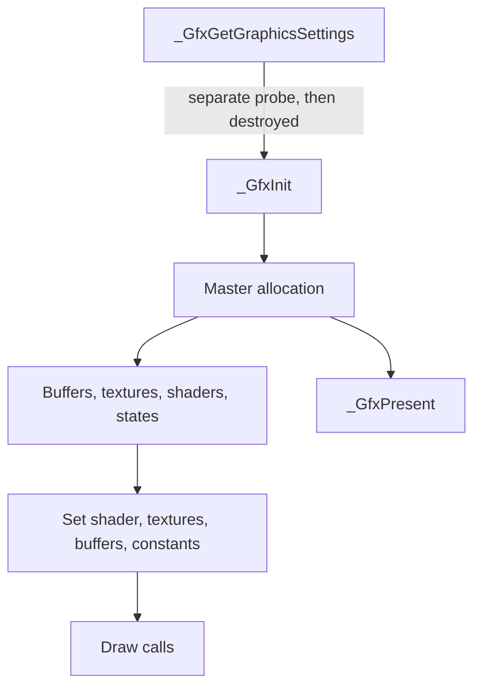

# Backend, as the 92 functions implement it

Start here. The per-function readings are linked. This is a synthesis of those readings and of [gfx-init-handoff](../../../../analysis/metal-census/v1/gfx-init-handoff.md). It does not resolve the indirect sites that handoff left open.

## Frame

`_GfxGetGraphicsSettings` runs as its own GL probe. It is not a step inside `_GfxInit`. It must still produce the settings object, because callers use those fields, and it calls `_glewInit` on a window it then destroys.

`_GfxInit` then builds the master described in [types.md](types.md) and returns it. `_GfxGetMasterContext` returns that pointer. `_GfxGetImmediateContext` and the deferred-context pair do not create a second device. `_GfxBeginScene` rebinds the default blend state. Draws consume the master. `_GfxPresent` swaps the SDL window stored on the master. `_GfxShutdown` deletes the GL context and the master.

`_GfxEndScene`, the lock functions, gamma, used-memory, and device-check are constants or empty. They are not a frame boundary.

## Resources

Create functions allocate a small header and, except for constant buffers and samplers, a GL name. Update functions bind that name and upload. Destroy functions delete the name where the body says so, and delete or recycle the header. Constant buffers are a CPU array plus a header cache. Samplers are translated integers, not GL sampler objects.

Textures and render targets share a `0x44`-byte header. A render target adds framebuffer and renderbuffer names. `_GfxSetRenderTarget` binds one of those framebuffers and stores the pointer. `_GfxResolve` copies the framebuffer into a texture. `_GfxResolveTexture` blits between two framebuffers.

## Shaders and draws

`_GfxBuildAndAddVertexShader` and the pixel twin call `BuildGLSL`, then compile. `_GfxSetShader` makes one shader current and marks constants and vertex attribs dirty. `_GfxSetConstantBuffer` only writes the CPU-side slot and the dirty byte. `_GfxSetVertexBuffers` records buffer pointers and marks attribs dirty. `_GfxSetTextures` binds immediately, through `InternalSetTextureAndSamplerState`.

A draw uploads dirty uniforms, enables dirty attribs, then issues one GL draw. Indexed draws use 16-bit indices. Base vertex and instanced indexed draws are separate entry points. Non-indexed instancing is an empty function. Line drawing in `_GfxDraw2dLines` is immediate mode, with the shader unbound for the duration.

## State

Blend, depth-stencil, and rasterizer objects are created from descriptions and applied by the setters, which skip unchanged fields. The default objects created in `_GfxInit` are what begin-scene and reset reapply. The depth-stencil default is the B1 description. Viewport and scissor write GL and, for the viewport, the master rectangle. Clear saves and restores masks around `glClear`.

## Outside this cut

The 92 are not the whole backend. Shader linking, texture upload format conversion, GLSL construction, and the actual sampler bind sit in `SShaderOpenGL`, `BuildGLSL`, `GetOpenGL*`, and `InternalSetTextureAndSamplerState`. Those names are listed in [dependencies.md](dependencies.md). Replacing a draw without those helpers leaves the bind path unfinished.

## What Metal `_GfxInit` has to leave behind

Established, from the init body and the handoff:

- A master pointer in `gMasterContext`, also stored at offset 0, size `0x198`, returned to the caller.
- The success byte. In this body it tracks GLEW init, not merely window lookup.
- An SDL window pointer at `+0x178`. The window itself comes from `SDL_GetWindowFromID`.
- Something callers can treat as the context pointer at `+0x180`. Today that is an `SDL_GL_CreateContext` result. A Metal drawable is not that pointer.
- Width and height at `+0xa0` and `+0xa4`.
- Capability bytes from `+0x188` through `+0x192`, including the max-texture query `0x0d33` and the GLEW flags `_GfxGetCaps` copies out.
- Default blend, depth-stencil, and rasterizer objects at `+0x80`, `+0x88`, `+0x90`, with the B1 depth-stencil values, and the three embedded snapshots at `+0xc`, `+0x30`, and `+0x54`.
- A 4x4 fallback texture at `+0x98`.
- Dirty bytes at `+0x128` and `+0x170` clear, and the wireframe byte at `+0x194` clear.
- The settings object produced by `_GfxGetGraphicsSettings`, including anisotropy, the sample-record walk, and the constants it writes. That function's temporary GL window is destroyed before it returns.

Unresolved, and not required to be solved in the reading:

- The fourteen indirect calls inside `_GfxInit` that the handoff could not name. Several indirect sites in the decompilation are C++ stream facet calls. That does not close the handoff's machine-level list.
- Which GLEW flags later draws actually test, beyond the bytes stored on the master.
- The numeric format argument of the 4x4 texture.
- Whether `+0x180` must remain a real GL context for any caller that is not one of these 92.
- The meaning of the settings constants `0x400` and `0x30000000300`.
- Alias between the `_GfxForceWireframe` argument and the master. The rasterizer setter reads `+0x194` on the handle object. The wireframe function writes `+0x194` on a raw pointer.

A later init implements the established list and stops at the first unresolved item that a real caller requires. It does not add a startup checkpoint.
