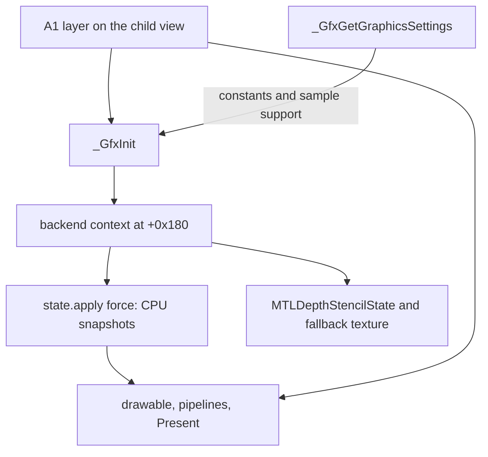

# Metal init interface

This is the contract a Metal `_GfxInit` implements. [Decision 0001](../../../../docs/decisions/0001-semantic-gfx-then-metal.md) stays in force. This file does not implement that function, authorize a live process change, or add a startup checkpoint.

The reading is [architecture.md](architecture.md), [types.md](types.md), and [unknowns.md](unknowns.md). Field displacements below are the ones that reading already records. The B0/B1 record is [gfx-init-handoff](../../../../analysis/metal-census/v1/gfx-init-handoff.md). A1 attached the layer; that result is recorded in [status.md](../../../../docs/status.md).

## Engine-facing ABI

Patch the existing entry RVAs. The master stays a `0x198`-byte block, stored in `gMasterContext` and at offset 0, returned in `rax`.

Retained readers keep the displacements in [types.md](types.md): the window at `+0x178`, size at `+0xa0` and `+0xa4`, the viewport at `+0xac` (`0x18` bytes, what `_GfxGetViewPort` copies), the argument word at `+0xa8`, the capability span below, dirty bytes `+0x128` and `+0x170` clear, the wireframe byte `+0x194` clear, default objects at `+0x80`, `+0x88`, and `+0x90`, and the fallback texture at `+0x98`. On success the current shader pointer at `+0x70` is null.

On success the success byte is 1, and the master and every required backend-owned resource exist. The byte means those postconditions. It does not mean `_glewInit` succeeded. On failure the byte is clear and the returned allocation is safe for the caller cleanup the original return already expects. A Metal object created before the failure is released once. An engine header is either installed in the master or freed before return.

## Device, queue, and context

`+0x180` is the backend context. It is not an `SDL_GLContext` and not a drawable. Among the 92, only `_GfxShutdown` consumes it. An outside caller that still treats it as GL is a later stop, not a reason to create a GL context.

Init does not call `SDL_GL_*`, `_glewInit`, `glGet*`, `InitOpenGLConversionTables`, or `GetOpenGLContext*`.

A1 gets the `NSWindow` with `SDL_GetWindowWMInfo`, inserts a child `NSView` in `native.contentView`, and sets that child's `layer` to the `CAMetalLayer` ([eu4_metal_boot.m](../../../../benchmark/eu4_metal_boot.m)). `contentView.layer` is not that layer. Bootstrap holds the child-view layer in its private `g_layer`.

- A1 owns layer creation and attachment. Init does not create a second layer or a second hosting view.
- `backend.adopt` receives that child-view layer pointer from the existing boot integration. Init does not read `contentView.layer` and does not search subviews. If the handoff pointer is nil, init fails.
- The backend device is `layer.device`. If that is nil, init assigns `MTLCreateSystemDefaultDevice()` on that same layer.
- The queue `_GfxShutdown` destroys is the backend queue. Bootstrap's private `g_queue` is not a second live queue. The continued-execution path either does not create it, or transfers it into the backend.
- Drawable acquisition and encoding come later. `_GfxPresent` submits the completed frame. Neither runs as part of init.

## `_GfxGetGraphicsSettings`

This probe may run before the primary window and the A1 layer exist. It creates no window, no GL context, and no long-lived backend. It obtains a temporary device with `MTLCreateSystemDefaultDevice()`, queries that owned reference, and releases it before return. It does not read another object's `device` property.

Writes on the caller object stay the ones in [types.md](types.md): byte `+0x10` is 1, and the immediates are `0x30000000300` and `0x400`. What those immediates mean stays unknown. Anisotropy at `+0x14` is 0. Metal has no device query that replaces the old GL anisotropy probe. The `0xc`-byte sample-record stride stays. Which fields sit inside a record stays unresolved. Supported sample counts come from `supportsTextureSampleCount:` on the temporary device. A record is emitted only for a count that device accepts. Implementation reads the sealed settings body to place that count.

## Capability span

`_GfxGetCaps` copies 8 bytes at `+0x188` and 4 bytes at `+0x18f`, so init writes `+0x188` through `+0x192` inclusive. The byte at `+0x18f` is one value.

There is no `MTLDevice.maxTextureSize`. The advertised max-texture dimension is stored at the displacement the sealed `_GfxInit` body uses for query `0x0D33`. It is 8192 when the device supports only `MTLGPUFamilyApple2`, and 16384 when the device supports `MTLGPUFamilyMac2` or `MTLGPUFamilyApple3` or a later family, including Apple10. 16384 is an advertised cap. Apple10's published 2D maximum is 32768, and this contract does not report that maximum. Every other byte in the span is 0. A later caller that requires a nonzero flag names that byte.

## Initial objects

Call the original `GetDefaultBlendState`, `GetDefaultDepthStencil`, and `GetDefaultRasterizer`. The static graph shows no calls and no GL references from those three. Depth-stencil description bytes stay the B1 record: test on, write on, less-equal, stencil Always/Keep, all-ones masks. Byte `0xc` stays in the CPU record. Do not call `SOpenGL*::Init` or the `GetOpenGLContext*` readers.

Engine headers keep the sizes and description offsets in [types.md](types.md). `_GfxGetBlendStateInfo` and `_GfxGetTextureDescription` keep reading the CPU description. The backend owns GPU resources in metadata keyed by the engine object pointer. A Metal reference is never stored in a 32-bit GL-name field.

- Depth-stencil can be an `MTLDepthStencilState`, created at init from the B1 description.
- Blend stays CPU state until a pipeline exists. Init does not create an `MTLRenderPipelineState`.
- Rasterizer stays CPU metadata plus later encoder state. Init does not build a pipeline for it.

`GetDefault*` descriptions, the objects `SOpenGL*::Init` used to build, and the snapshots at `+0xc`, `+0x30`, and `+0x54` are related and are not assumed byte-identical. `state.apply(force)` writes the logical state and those snapshots in the representation their surviving consumers already read. It derives that representation from the engine description. Force skips the redundant-state check. It does not copy a description onto a snapshot. Implementation fills only the snapshot fields a consumer of the defaults actually reads. Remaining blend and rasterizer fields stay unknown until a caller uses them. GPU encoder state and pipelines are configured later from that logical state.

Do not call `GfxCreateTexture` for the fallback. That helper calls `_GfxCreateTexture`, which uploads through GL. Init stores a `0x44`-byte header at `+0x98`. It is the texture `_GfxSetTextures` substitutes for a null bind: one mip, not a render target, sampleable as that substitute. The numeric format argument is unresolved. Implementation confirms the operand in the sealed init body before choosing an `MTLPixelFormat`.

The backend owns GPU references. The master owns the engine headers init creates: the three default-state headers and the fallback header. Shutdown releases each of those headers with the engine allocator and releases the associated backend resource exactly once. After a header is freed it is not registered in backend metadata.

## Services init calls

Init calls `backend.adopt` with the handed-off child-view layer; `state.create` from a `GetDefault*` description; `state.apply` with force; and `texture.create_fallback`. Header `operator.new` and `operator.delete` stay the engine allocator. GPU ownership stays in the backend.

## What is replaced with init

These six entries are the engine patch set, because init calls them or they own `+0x180`. They are not the whole startup path. PR3 keeps A1's child view and its layer, and it keeps the bypass of `SDL_GL_SetSwapInterval` at `0x13cc1e4` (`eu4_metal_boot_on_swap` returns 0). It does not keep the terminating `_glewInit` hook at `0x15e91fd`. `a1` exits after the synthetic clear. `bootstrap` exits at that hook. Neither is the continued run. The original `_GfxInit` body is replaced, so it does not create a GL context. This adds no checkpoint.

- `_GfxGetGraphicsSettings`
- `_GfxInit`
- `_GfxSetBlendState`, `_GfxSetDepthStencilState`, `_GfxSetRasterizerState`
- `_GfxShutdown`

`_GfxBeginScene` stays `replace-metal`, as in its [dossier](init/_GfxBeginScene.md). It is not in this set. Its indirect call at `0x15ea71f` disables vertex-attrib arrays when a shader is current, and that branch is GL-dependent. Successful init leaves `+0x70` null, so a call before `_GfxSetShader` does not take the branch. It still calls `_GfxSetBlendState`. Replace `_GfxBeginScene` when execution reaches the shader-current branch.

Specified now, patched when a run reaches them: `_GfxReset` and `_GfxOnResetMasterContext` (force-apply through the same setters, no GL readback), `_GfxPresent`, drawable acquisition, the `_GfxCreate*` state wrappers, texture upload, draws, and shaders. The six functions above are the initial scope. They are not a proof that startup finishes with only those six.

Every other current entry stays original across this milestone, including `_GfxGetMasterContext`, `_GfxGetImmediateContext`, `_GfxGetCaps`, `_GfxGetViewPort`, `_GfxForceWireframe`, the constant-buffer functions, and header destroys that only call `operator.delete`. A retained function that still contains GL fails at its own first call.

## Not settled here

These are not prerequisites for this contract, and they are not declared irrelevant.

- The fourteen indirect calls inside `_GfxInit`. Implementation inspects any one whose side effect the postconditions require.
- The wireframe pointer alias.
- The meaning of the settings immediates, and the fields inside a `0xc`-byte sample record.
- Blend and rasterizer enum tables beyond `GetDefault*`.
- The fallback texture's format operand.
- Whether any non-`_Gfx*` caller reads `+0x180` as GL.
