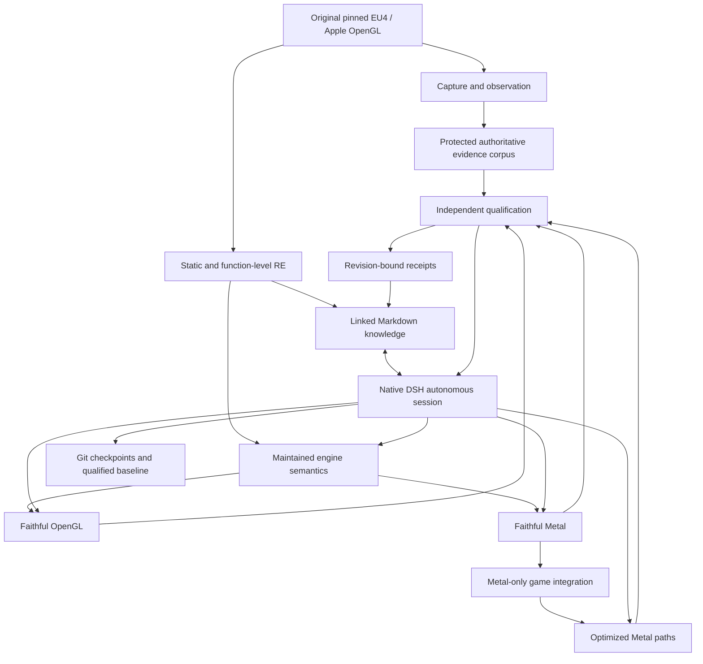

# EU4 — Target repository, knowledge architecture and integrated refactoring plan

**Date:** 2026-11-25

**Repository:** `HagbardCel/eu4-mac-perf`

**Status:** Proposed implementation plan; no implementation or source-level audit has yet been performed under this plan.

**Companion strategy:** `eu4-autonomous-renderer-roadmap.md` (25 November 2026).

## 1. Executive decision

Transform the repository from a collection of historical rendering experiments and campaign-specific automation into a small, coherent engineering project whose primary deliverable is a maintained, faithfully reconstructed renderer. The repository must make the next authentic reconstruction easier, faster and more reliable for both humans and autonomous agents.

The strategic workstreams are:

1. **Faithful OpenGL:** reconstruct the original EU4 rendering behavior, with exact observable state, resource and output equivalence. Independently reconstruct the relevant Clausewitz `_Gfx*` functions and qualify their state transitions and command generation.
2. **Faithful Metal:** translate qualified behavior into Metal, using controlled experiments to separate engine errors from API and driver differences.
3. **Game integration:** replace the renderer at the appropriate binary boundary and validate representative authentic workloads. Keep production execution Metal-only; no GL/Metal interoperability requirement.
4. **Optimized Metal:** improve performance against a qualified faithful implementation, while preserving correctness.

These are rolling workstreams. Do not require reconstruction of the entire original engine before performing a bounded Metal migration. Do not claim engine reconstruction on the basis of command replay alone.

The operating model is continuous development: a native DSH agent advances the appropriate workstream for two hours by default or until genuinely blocked. It selects the next task, locates reference evidence, conducts research and experiments, modifies maintained code, independently validates improvements and records findings. The operator should not have to select a capture, event number, per-session manifest or custom acceptance script. Git preserves changes at least after every goal round.

**Scope of this refactor:** all repository responsibilities that serve this target, including source ownership, evidence and knowledge retention, agent interfaces, orchestration, tests, development ergonomics and historical cleanup. The refactor itself is not a mandate to reconstruct the renderer manually, to build a general GPU emulator, or to redesign the entire engine.

## 2. Repository philosophy and non-negotiable constraints

| Principle | Engineering consequence |
|---|---|
| One owner per capability | Consolidate equivalent implementations, not merely their directory names. |
| Permanent capabilities, temporary experiments | Promote useful mechanisms into maintained code; retain findings; remove disposable code. |
| Original EU4 remains authoritative | An intermediate OpenGL implementation earns qualified reference status only for verified scope. |
| Exact OpenGL equivalence | A pixel-only pass cannot conceal incorrect relevant state or memory effects. |
| Evidence before hypotheses | Record provenance, uncertainty and negative results; never turn missing data into a pass. |
| Native agent runtime first | Use DSH native goal continuation; do not implement another scheduler or progress engine. |
| Git owns source history | Use ordinary commits, protected refs and worktrees instead of a custom implementation checkpoint store. |
| Independent qualification | Candidate code cannot choose easier required tests, rewrite reference observations or alter the trusted validator. |
| Demand-driven abstraction | Share real common semantics, not speculative APIs or an OpenGL-shaped Metal abstraction. |
| Fast feedback, strong final verification | Run the smallest meaningful tests during experimentation; protect all qualified behavior at promotion. |
| Local evidence stays local | Do not commit proprietary payloads, game binaries, raw captures, credentials or generated outputs. |
| Net enabling-refactor LOC ≤ 0 | Measure source, infrastructure, tests and docs separately; do not sacrifice scientific or safety coverage to meet the target. |

Prefer deletion and consolidation over cosmetic relocation. No new framework, schema, service, launcher, cache, test runner or generic wrapper without a demonstrated gap that cannot be closed simply in the existing implementation. The active repository must not retain a permanent `legacy/` dumping ground or the executable scaffolding of completed refactoring phases. Git history provides recovery of previously tracked files; external evidence retention is separately required.

## 3. Target architecture



The diagram expresses logical responsibilities, not a new mandatory abstraction. Low-level replay feeds the maintained backends without claiming to execute reconstructed engine semantics; function-level reconstruction feeds the same backend where feasible. Runtime dependencies flow from integration and engine code into backend-specific operations, not from production renderer code into diagnostic, orchestration or experiment machinery.

### 3.1 Proposed working-tree structure

```text
AGENTS.md                     # concise startup instructions, rules and navigation
README.md                     # purpose, setup, standard entry points
docs/                         # architecture, operator workflow, development, current status
renderer/                     # canonical maintained implementation
    engine/                   # recovered engine functions, ABI-independent semantic state
    opengl/                   # faithful GL reference backend
    metal/                    # faithful Metal backend, optimized paths as justified
    integration/              # binary ABI adapters, hooks and game integration
    shared/                   # only demonstrated cross-backend reuse, if needed
tooling/                      # reusable investigation and qualification
    capture/                  # live original observations
    replay/                   # input loading, execution adapters and case reduction
    validation/               # comparisons, independent execution, receipt verification
    diagnostics/              # state/command/resource divergence localization
    profiling/                # maintained performance measurement
reverse_engineering/          # pinned target, corpus acquisition, indexed queries
    ghidra/                   # maintained extraction and analysis utilities
knowledge/                    # canonical scientific knowledge
    README.md                 # navigation by component, function and question
    architecture.md           # established original renderer behavior
    functions/                # function contracts, source links, evidence
    components/               # textures, shaders, raster, depth, lifecycle, etc.
    backends/                 # GL/Metal contracts and API-specific findings
    experiments/              # curated positive and negative findings
evidence/                     # small protected reference metadata and locators
    README.md                 # corpus policy, recovery, storage locations
    ...                       # existing manifest/registry representation, not a new DB
agents/                       # logical agent integration ownership
    ...                       # thin adapters, shared methodology, DSH integration
tests/                        # maintained tests grouped by responsibility and execution tier
.local/                       # ignored run output, builds, working fixtures
```

This is a proposed target, not a path-by-path migration order. In particular, retain DSH's existing discovery paths (`dsh/`, `.opencode/skills/`) if moving them would require unnecessary compatibility shims. `agents/` is a logical ownership boundary, not a requirement to duplicate or relocate established runtime paths. Likewise, `knowledge/` could be realized under `docs/renderer/` if that avoids redundant documentation trees; select one physical location during R0 and remove the other. Keep native build and packaging conventions where they are already sound.

### 3.2 Migration from existing areas

| Current area | Intended disposition (subject to source/dependency audit) |
|---|---|
| `benchmark/` | Move actual renderer implementation and reusable capture/replay/profiling functionality to their permanent owners. Retain supported profiler entry points only if still used. |
| `automation/` | Consolidate evidence, replay, comparison, diagnostic and test mechanisms by responsibility. Retire obsolete milestone orchestration. Preserve supported CLI behavior during migration, without indefinite parallel interfaces. |
| `analysis/` | Extract maintained semantics and positive/negative findings; promote reusable code and fixtures. Remove superseded experiments after evidence review. |
| `results/`, `measurements/` | Preserve unique authoritative payloads and measurement provenance; keep compact locators in the active tree and move appropriate bulk data outside it. |
| `campaigns/`, `dsh/campaigns/` | Replace routine per-target configuration and wrapper checkers. Retain historical scientific conclusions and any necessary frozen reproducibility material; remove runnable machinery after replacement is proven. |
| `reverse_engineering/` | Retain the pinned corpus/query capability; consolidate duplicate exports and generated artifacts only after validating recoverability. |
| `dsh/` and shared skill | Retain native runtime provisioning, tool integration and lifecycle primitives that are genuinely required. Retire custom campaign-specific continuation and finalization where redundant. |
| `docs/`, `plans/` | Establish one current architecture, one status/navigation entry point, canonical operational instructions; remove superseded active plans after preserving useful conclusions. |

R0 must establish the actual paths and owners. Do not interpret this table as a deletion allowlist.

### 3.3 Renderer implementation rules

- Recover engine-specific resource ownership, state transitions, dirty flags, shader/texture selection, draw preparation and relevant helper semantics centrally. Keep ABI layout and binary adaptation explicit and version-pinned; avoid assuming a native ARM64 library can load into x86-64 EU4 under Rosetta.
- OpenGL and Metal own their own GPU resource lifetimes, API-specific calls, shader compilation, pipeline/state representation and synchronization. Shared code must reflect established common behavior, not impose a uniform execution model on the optimized Metal path.
- Replay, controlled GPU experiments and integration should consume maintained implementation code. A separate harness adapter may be necessary, but a second renderer implementing the same semantics is not a desirable steady state.
- Link reconstructed functions to their canonical evidence notes. Maintain readable handwritten behavioral reconstruction; original binaries, bulk decompiled source and proprietary shader/texture bytes remain local, consistent with repository conventions.
- Preserve original engine behavior before optimization. Keep optimized paths switchable against the qualified faithful Metal reference when that is useful for testing; avoid permanent wholesale copies of the faithful backend.

## 4. Scientific correctness and reference evidence

### 4.1 Two independent OpenGL qualification scopes

| Scope | Inputs to candidate | Independent comparison |
|---|---|---|
| GL replay | Verified initial state and recorded exogenous commands/resources | Normalized command effects, GL context and resource state, actual attachment contents and rendering output |
| Engine reconstruction | Original function inputs, relevant pre-state and external inputs | Independently generated normalized commands, return values, relevant memory/object effects, GL state transitions and output |

Replay may use captured commands because they are its input. Engine reconstruction must derive those commands itself. Neither may receive expected post-state or expected output as a substitute for execution. Initialize at a defined boundary, then execute continuously over the qualified sequence; do not silently reinitialize from the original state before each transition to hide accumulated errors.

For exact GL qualification require matching defined observable behavior, including state that does not yet affect pixels. Compare logical resource IDs rather than process-specific numeric handles or raw pointer addresses, using a validated lifetime/alias mapping. Require exact buffer contents, texture formats/mips/compressed blocks, uniform values, shader sources and effective linkage, sampler settings, attachments, viewport/scissor, blend/depth/stencil/raster state, relevant errors, resource lifecycle and observable color/depth/stencil contents. Check independently observed candidate state, not a copy of the requested input manifest. Track capture, restoration and comparison coverage separately.

Private driver caches and opaque GPU internals are not directly required to be byte-identical. Undefined, unspecified, inaccessible or lossy state cannot be silently treated as equal; report the scope and limitation and refuse full qualification when required observations are unavailable. A defined, losslessly observable depth-buffer comparison is stronger than comparing converted readback values. An exact pixel match by itself is insufficient.

### 4.2 Environment identity

The repository already pins GOG EU4 1.37.5 macOS x86-64 with SHA-256 `b3d38876abf4e61cdae57509186d7cb7dcb03bfeaca4c95c10c713794715141d` in `reverse_engineering/target.json`. Verify against current HEAD and the actual binary. Extend the existing identity mechanism, not a parallel manifest, to record relevant game assets, macOS build, GPU identity, Apple GL renderer/framework identity where observable, effective GL version/profile/extensions, CGL context/drawable configuration, shader compilation/linkage configuration, dimensions and scaling. Start with x86-64 under Rosetta for reference replay if feasible; independently qualify any change to native ARM64, driver or OS before combining evidence.

Do not assume that same API guarantees identical behavior. Do not substitute Mesa, ANGLE or a software renderer as the authoritative Apple OpenGL reference. Use other implementations only as labeled diagnostic controls if warranted.

### 4.3 Corpus and automatic reference resolution

The authoritative corpus is a collection, not necessarily one latest frame. It may contain different workloads and per-function fixtures. Existing capture seals and case locators should provide stable identity, verified integrity, reference authority, scope, environment and coverage. Prefer the evidence already available; acquire new original observations only for a demonstrated gap.

| Evidence class | Valid claim |
|---|---|
| Original live EU4 | The behavior actually observed under the pinned conditions |
| Verified original instructions/static analysis | The inspected code/identity; inferred semantics remain hypotheses until supported |
| Derived authentic case | The explicitly retained derived scope, not an entire original frame |
| Synthetic or microbenchmark | The isolated controlled behavior, not global EU4 fidelity |
| Qualified GL reconstruction | A reusable executable reference for exactly its qualified scope; original EU4 remains ultimate authority |

Resolve references automatically by target identity, workload, required observables, scope, integrity and applicability. Use existing `case_locator` and `eu4_session` discovery; do not add a filesystem-wide scanner or parallel database. The newest capture may be inadequate; do not merge unrelated seal results. An unresolved required identity, ambiguity or missing payload must be surfaced, not silently handled by an easier fallback.

The operator maintains the protected corpus and required regression policy. The agent can choose useful diagnostic cases, but cannot change required acceptance scope. Record which evidence and scope were actually used; avoid hand-maintained per-session reference paths. References selected for qualification are fixed for that validation invocation; newly added authoritative cases must be independently approved/verified and incorporated without erasing previous failures.

### 4.4 Independent reusable validators

Reuse and extract the trusted execution path in `automation/gfx_prefix_check.py` and associated comparators. Provide permanent GL replay, engine-function and Metal qualification modes through common evidence/receipt mechanisms. The validator resolves required cases, independently builds/executes candidate source, observes results and recomputes equality. Bind receipts to candidate commit/tree and executable, original binary/environment, case/manifest digest, validation contract version, exact scope and observations. Preserve distinctions between invalid evidence, unsupported state, missing required observations, execution failure, qualified match and qualified difference.

For GL, require exact observable equality, no arbitrary tolerance. For Metal, establish exactness wherever achievable and characterize any inherent difference through controlled experiments; any equivalence relaxation requires explicit operator approval and must not be labeled raw exactness. For optimization, require matched-workload fidelity and measured improvement against faithful Metal. Preserve all previously qualified behavior; a later-event match with an earlier regression is not progress.

Validation is not automatic merge approval. Candidate-authored receipts, screenshots, test results or metadata alone cannot establish qualification. Protect trusted source, inputs, policies and required outputs from modification by candidate execution; verify the actual isolation boundary. A separate directory or Python subprocess alone is not a security sandbox.

## 5. Knowledge architecture

The knowledge base is an operational dependency of the agent, not an archive of everything that happened. Optimize for reliable answers to a specific engineering question with the fewest necessary reads and tokens.

### 5.1 Canonical knowledge domains

| Domain | Canonical content |
|---|---|
| Original renderer architecture | Established rendering flow and boundaries; unresolved direct/indirect dependencies |
| Function dossiers | Symbol, RVA, identity, ABI, inputs, outputs, side effects and reconstruction |
| Components | Cross-function resource/state semantics, lifecycle and dependencies |
| Backends | OpenGL/Metal-specific behavior and demonstrated differences |
| Scientific findings | Positive and negative experiments, scope and reproducibility |
| Qualification | Verified coverage and limits, linked to independently generated receipts |

Use Markdown links as the initial graph. Link functions to components, experiments, implementation and evidence; link source comments back to knowledge. Use stable symbol + RVA + pinned target identity where names are ambiguous. Use existing RE index for inventories and on-demand disassembly; do not create empty dossiers for every function. Avoid re-copying facts across several documents; use links and concise summaries. Do not build a vector database or graph service.

### 5.2 Function dossier template

```markdown
# <symbol> — <RVA>

- Original target / ABI:
- Purpose and established behavior:
- Relevant entry state and inputs:
- Return values, memory effects and external GL effects:
- Layouts, lifetime and dependencies:
- Maintained reconstruction: [source](#example)
- Evidence: [instructions](#example), [runtime observations](#example)
- Qualification: [receipt/locator](#example) — exact scope and limitations
- Rejected hypotheses: [finding](#example)
- Unknowns / smallest next observation:
```

Only assert established facts at the correct evidence tier. Keep provisional inferred fields distinct from qualified layouts. A static dossier is not itself executable proof. Its associated tests/validator supply that proof.

### 5.3 Experiment note template

```markdown
# <stable question-oriented finding>

- Question and competing explanations:
- Scope: original seal/case, target, environment and candidate revision:
- Intervention and control:
- Observed result:
- Conclusion: confirmed / supported / refuted / inconclusive / superseded:
- Limitations and what remains unknown:
- Evidence locator and reproduction method (if retained):
- Related functions, components and implementation changes:
```

Preserve negative outcomes with conditions under which they are valid. A tool refusal is not a refutation of a rendering hypothesis; a non-discriminating experiment is inconclusive. Mark stale findings as superseded and link the stronger evidence. Consolidate equivalent attempts rather than creating permanent pages for every replay. Preserve unique original observations and methods needed for unresolved scientific questions; remove temporary experiment code when the outcome and useful capability have been captured.

### 5.4 Agent context and source of truth

| Context layer | When loaded |
|---|---|
| Compact `AGENTS.md` and one reconstruction skill | Startup; permanent methodology and constraints |
| Current status / knowledge index | Session start; qualified baselines and open gaps |
| Targeted function/component/finding notes | When investigating a question |
| Raw binary and runtime evidence | On demand through bounded existing queries |

Git is the source of truth for implementation and history. The knowledge base is the source of truth for our understanding and open questions. Sealed evidence is the source of truth for observations. Independent receipts establish verified scope. A status projection may summarize these, but is not a separate mutable progress system. Record a qualified revision and its scope rather than saying that a function or component is universally complete.

Use existing search, `eu4_re_query`, `eu4_research`, bounded results and report locators. Keep startup context concise and avoid sending full disassembly, logs or large manifests to the model unless necessary. Measure actual retrieval cost and repeat investigations before introducing further search infrastructure.

## 6. Continuous autonomous development and Git recovery

### 6.1 Operating model

The normal operator experience is to start the current workstream for 120 minutes. The project default should be faithful OpenGL until the roadmap changes; an optional workstream override is sufficient for later Metal work. No manual event or capture selection, no bespoke goal/sidecar/checker, no session-specific task queue.

Permanent objective:

> Advance the faithful OpenGL reconstruction autonomously for two hours or until no meaningful progress is possible without external intervention. Discover the current verified implementation and evidence, select the next unresolved task, research, experiment, implement, independently validate and document. Preserve previously qualified behavior and checkpoint changes in Git at least after every goal round. Continue after individual successes. Leave coherent, recoverable work and precise evidence requests for blockers.

Adapt the workstream label and validation contract for Metal migration and optimization. Keep permanent details in the shared skill rather than copy them into every goal. The goal is an allocation of time, not a fixed event milestone.

### 6.2 Agent loop

1. Verify baseline, workspace and current evidence coverage; identify regressions or unresolved work.
2. Prioritize regressions, earliest relevant semantic divergence, missing required observations and then the next useful function or dependency. Choose the next actionable question by reasoning; no task scheduler.
3. Retrieve existing knowledge and negative findings before experimenting. Prefer small offline discriminating experiments using maintained code; inspect the first relevant state divergence, not just pixels.
4. Reconstruct or correct code. Run focused tests and independently validate meaningful changes against protected scope.
5. Record findings and unresolved gaps; preserve code and notes in Git. Move to the next useful task until the deadline or a genuine blocker.

A disproved hypothesis, an inconclusive experiment or one blocked function is not a reason to stop if independent meaningful work remains. A genuine blocker specifies the affected scope, missing evidence or capability, attempted alternatives, the smallest requested observation and the consequence. Live original EU4 acquisition is an operator-authorized workflow, separate from the offline session. Do not give the agent an operator launch token.

### 6.3 Minimal lifecycle and trust model

Reuse the existing non-campaign DSH mode (`dsh/scripts/run.sh --workspace ...`) as the first candidate, not a proven finished solution. Investigate the pinned DSH version's actual goal lifecycle, deadline/cancellation hooks and child process behavior. Native goal continuation owns repeated rounds. If a hard deadline or round hook is absent, extract the smallest existing lifecycle primitive required; no replacement goal driver or second scheduler.

Enforce the deadline externally, including terminal commands and GPU workers where applicable. Reserve enough of the time budget for orderly finalization; do not renew the deadline on resume. At expiry or cancellation stop owned execution, preserve work and report unvalidated changes separately. Reuse process identity checking, host-wide EU4 lease, GPU serialization, offline launch refusal and authorized capture mechanisms. Keep explicit protection if a simpler design cannot yet enforce the same invariants. Avoid fixed quotas on replays, goal rounds or corrections.

The existing experiment rationale should be reduced to useful scientific information (question/hypothesis, intervention, expected discriminator, actual result) where possible. Do not require form-filling for read-only inspection or routine focused tests. Preserve useful provenance and independent verdict semantics. Avoid another progress/telemetry service.

### 6.4 Git checkpoints and recovery

| Boundary | Required behavior |
|---|---|
| Session start | Dedicated branch/worktree, record starting commit, clean or explicitly preserved pre-existing changes; locate latest qualified baseline |
| Before risky/destructive experiment | Commit coherent current work; no reliance on uncommitted or ignored files as the sole recovery copy |
| Within a round | Commit meaningful units where useful; retain documentation of negative outcomes even when code is reverted |
| Every completed goal round | External lifecycle checkpoint for all intended authored changes; no empty commits required; record unchanged round/head |
| Deadline, cancellation, error | Quiesce owned workers and snapshot remaining eligible changes through trusted lifecycle path; mark partial/unqualified |
| Next session | Resume retained history, verify receipts and baseline, continue without losing discoveries |

Checkpoint and qualification are separate. A WIP commit does not imply correctness. Qualified receipts bind the exact source revision/tree and reference; retain an identifiable protected qualified ref and recovery refs. Candidate branch history must be recoverable even if an agent attempts destructive operations. Verify how external checkpointing protects shared Git metadata; ordinary Git worktrees share objects and refs, and a worktree alone does not enforce isolation. Prevent unauthorized ref deletion, force-push, destructive history rewriting and writes to trusted infrastructure/reference paths by enforceable permissions or isolated execution. Do not rely solely on prompt rules. Do not merge automatically.

Stage tracked and eligible untracked authored code/tests/docs according to an approved policy; reject secrets, binaries, proprietary assets, raw evidence and generated build output. Do not blindly `git add -A`, nor discard files merely because they were not already tracked. Report unexpected files and failed checkpoints explicitly. A failure to preserve a round must stop continuation rather than silently losing changes. Protect checkpoints outside the candidate's ability to erase them; use ordinary Git mechanisms, not a custom source snapshot database.

## 7. Legacy cleanup and evidence retention policy

For every historical artifact, establish one disposition:

| Disposition | Criteria |
|---|---|
| Retain maintained | Active supported entry point, dependency, unique invariant or evidence-producing capability |
| Consolidate | Overlapping useful mechanism; transfer behavior to canonical owner and retire duplicate |
| Retain finding only | Valuable scientific outcome; code is superseded and no longer needed to reproduce essential evidence |
| Archive payload | Unique evidence or relevant historic measurements; verify digest and retrievability outside active tree |
| Delete | Obsolete or equivalent artifact, no remaining scientific/operational dependency |

Review M1–M6 and later campaigns using the same policy, not an age cutoff. Remove dead launchers, milestone fixtures and tests for deleted behavior after verifying replacement and dependency closure. Preserve original observations, unique negative findings, required regeneration methods and historic measurement identities. If reproduction relies on an old commit, record that commit and the required local inputs. Git does not recover untracked captures; verify external retention before deleting their only copy. Do not rewrite Git history or remove tags solely to reduce working-tree size. Avoid permanent compatibility aliases and archive folders unless an actual supported caller requires them; time-box transitional paths with explicit removal conditions.

## 8. Test and feedback-loop redesign

### 8.1 Test tiers

| Tier | Purpose | Routine trigger |
|---|---|---|
| Fast portable semantic/unit | State transformations, resource mapping, parsing, comparator and contract logic | Relevant code change |
| Focused native backend | Real Apple GL/Metal behavior and integration at API boundaries | Affected backend change |
| Authentic qualification | Exact original observations and protected regressions | Promotion of renderer behavior |
| Full maintained offline gate | Integrated correctness and safety, no real EU4 launches | Once before merge on retained changes |
| Live EU4 | Missing original observation, end-to-end integration | Explicit operator authorization |

Git checkpointing does not trigger a full suite. Keep existing `automation/test_runner.py` or its consolidated owner; do not add a test cache. Reuse valid build products when source/toolchain identity is verified, including exact rollbacks. Do not run multiple equivalent validations through wrappers or repeatedly after documentation-only edits. Keep skip vs failure semantics explicit, including native prerequisites unavailable on CI. A portable gate does not substitute for actual macOS GPU qualification.

### 8.2 Audit and optimization method

Measure cold and warm builds/replays, test runtime by module, subprocess/build counts, fixture loading, hashing/I/O, duplicate wrapper tests and repeated agent invocations. Separate elapsed wall time from GPU time; do not infer device service time from host duration. Use comparable revisions/host/toolchain and record exact suite composition, skips, failures and changes in scope. Use existing traces, test-runner logs and DSH exports. Profile before choosing deletions.

Keep every unique correctness, ABI, provenance, resource lifecycle, safety and recovery invariant. Consolidate repeated cases that genuinely exercise identical behavior; use representative boundary cases for redundant combinatorial inputs; share native builds within a verified execution where appropriate. Replace tests of deleted mechanisms with tests of the replacement invariant, not merely a lower count. Preserve state-only faults, missing observations, tampered references, stale receipts, forbidden launch, interruption and regression negatives. An authentic regression test may subsume a synthetic test only if it covers the same relevant failure modes.

### 8.3 Proposed performance targets (calibrate at R0)

| Metric | Initial aspiration |
|---|---|
| Common read-only diagnostic | <1 second where feasible |
| Typical focused portable invocation | <10 seconds |
| Small native experiment with existing build | <30 seconds |
| Common authentic offline replay | <60 seconds |
| Full portable offline gate | <2 minutes where feasible |
| Comparable full offline validation wall time | ≥70% reduction, if invariant coverage is preserved |
| Unnecessary equivalent native builds | Eliminate |
| Routine autonomous original EU4 launches | Zero by default |

The historical November 21 status recorded 4,368 tests including 66 skipped; an earlier M7 offline gate took 721 seconds. They are dated observations from different revisions, not the current measured baseline. The numeric goals above are proposed performance aspirations, not permission to remove coverage or claims about present runtime. If a strong target cannot be met without harming scientific correctness, record actual improvement and remaining cost, and seek approval for any revised target.

## 9. Integrated implementation plan (R0–R7)

The phases below combine repository simplification with the enabling work in the companion renderer roadmap. They supersede the idea of two independent refactoring projects. Phase names are planning labels, not permanent module names, schemas, test names or runtime states. PR boundaries are recommendations; combine adjacent steps where the audit demonstrates a simpler safe route. Keep each retained PR buildable and independently reviewable. The local coding agent implements reviewed tasks; the reconstruction agent performs the scientific work after enablement.

### R0 — Source-level audit, measurement and deletion map

**Purpose:** establish the real current repository structure and cost; turn the target picture into a source-grounded implementation specification. This is a planning and measurement stage, not an opportunity to add permanent runtime code.

1. Pin current main HEAD and inventory relevant open PRs, local dependencies and native prerequisites. Separate current facts from dated status snapshots.
2. Inventory tracked authored source, tests, documentation and data, classified by responsibility; measure physical LOC and tracked byte size with a consistent method. Report generated/vendor/binary exclusions explicitly. Do not count a move as a reduction.
3. Trace supported public entry points, CLI/DSH tool registrations, dynamic subprocess and native build dependencies, binary symbol/hook callers, CI, docs and tests. Identify dead code by actual reachability and supported use, not by grep alone.
4. Audit all OpenGL control and Metal replay code, actual resource/state representation, capture/restore/observe/compare coverage, function oracle and ABI paths. For one authentic case record the state field, original observation availability, definedness, losslessness, candidate source of state, comparator and gap. Determine the smallest real missing discriminator before planning new code.
5. Audit evidence retention, corpus identity, case locators, trusted reference and independent execution paths. Verify whether required local payloads exist on the host; a repository locator is not proof of recoverability.
6. Audit DSH runtime and installed lifecycle hooks, deadline, cancellation, round checkpoint opportunity, child containment, permissions, Git isolation and campaign plugin dependencies. Determine whether `--workspace` mode can provide all required native lifecycle functionality. Record unresolved capabilities rather than assuming support.
7. Trace safety dependencies of `campaign_guard`, host lease, launch authorization, GPU lock, offline profile, trusted execution and finalization. Distinguish indispensable invariants from obsolete campaign plumbing.
8. Profile current tests and agent traces as specified in §8. Rank actual time sinks by cumulative wall time and repeated cost. Map each proposed test deletion to the invariant it protects and the retained alternative, if any.
9. Produce a disposition map for historical milestone code, generated artifacts and findings, including M1–M6 and M7. Inspect actual evidence and negative conclusions before deletion recommendations.

**Required audit output:** exact HEAD and measurement method; source and test LOC/bytes by owner; ranked runtime and complexity hotspots; capability and state coverage matrix; actual file/module-level keep/consolidate/relocate/archive/delete decisions, including dependencies and unique evidence; DSH lifecycle findings; trust/permissions gaps; proposed final physical paths; small PR specifications with acceptance and estimated removal opportunities. Link findings to current code, not merely documentation.

**Gate R0:** approve the disposition map and PR sequence. Do not authorize speculative deletion of unknown dependencies or expansion of runtime infrastructure. If current local evidence or installed DSH source is unavailable, state the limitation and identify the exact local inspection needed. Do not invent metrics.

### R1 — Canonical knowledge and historical findings consolidation

**Depends on:** R0 disposition and evidence inventory.

- Establish the single canonical knowledge location, concise startup navigation and links to existing static RE indexes. Consolidate `docs/eu4_renderer.md`, `docs/metal.md`, `docs/metal_optimized.md`, current status and useful analysis into their appropriate roles; retain operational instructions separately.
- Extract established engine semantics, format and API contracts, function identities, successful experiments, refuted hypotheses and unresolved questions from historical work. Preserve their exact evidence identities, conditions, scope and uncertainty; do not turn historic conclusions into universal claims.
- Start function dossiers with actual reconstructed functions and current unresolved dependencies. Link maintained source and receipts. Avoid bulk empty stubs and transcribed decompiler dumps.
- Publish/verify locators for unique external evidence before removing old copies. Record retention and restoration instructions and explicitly missing payloads.
- Replace stale instructions with one current source; retain short historical completion summaries only where needed to interpret evidence. Do not preserve duplicate operational instructions under new paths.

**Gate R1:** sampled findings from early and recent milestones, including negative and inconclusive results, are discoverable from component/function navigation; original evidence is recoverable or explicitly marked missing; source links and retained historical claims resolve. Demonstrate retrieval of a known fact and its evidence without reading entire campaign histories. No unique finding/evidence lost. Knowledge migration may proceed incrementally; no need to finish every document before safe code consolidation.

### R2 — Consolidate maintained renderer and reusable tooling

**Depends on:** R0 actual ownership decisions; R1 preservation for affected artifacts.

- Move or consolidate maintained source by permanent responsibility. Establish one GL backend and one Metal compatibility backend, one canonical home for recovered engine semantics and thin integration adapters. Preserve current functionality during moves; avoid broad cosmetic path changes and gratuitous abstraction.
- Promote the existing original-API GL control from an occasional diagnostic into a maintained candidate reference execution path. Inspect and reuse its actual implementation; do not write a second GL renderer if the first can be extended. Keep GL and Metal execution separate.
- Reuse shared replay loading, resource identity, event ordering, case verification, comparison and result reporting where semantically appropriate. Preserve GL-specific formats and state instead of converting to a Metal-shaped model before execution.
- Consolidate equivalent observation/replay/diagnostic entry points and thin agent adapters. Keep one Python core and CLI, with DSH adapters performing argument mapping rather than duplicating logic. Reuse `eu4_replay`, `eu4_case_inspect`, `eu4_diff_inspect`, `eu4_capture` and existing RE tools; naming changes only when worthwhile.
- Move relevant historical implementation code into maintained modules; delete superseded copies once all active callers/builds/tests are switched. Remove temporary aliases when migration is complete.

**Gate R2:** a clean checkout builds the retained paths; known cases execute through both backends using existing tools; protected Metal regression behavior remains unchanged on the same cases; no claim of GL equivalence without independent evidence. Document actual LOC additions/deletions by category and supported entry points. No new duplicate renderer or replay mechanism.

### R3 — Automatic evidence selection and exact observable qualification

**Depends on:** R2 stable execution boundaries. Evidence work can start earlier if it reduces risk.

- Extend existing evidence identity and discovery to resolve required references automatically, based on applicable scope and environment. Keep the trusted regression set outside candidate control. Demonstrate refusal on ambiguity, missing required observations, mismatched environment, invalid provenance and candidate attempts to exclude a failing case.
- Extend the reusable independent validator to execute the GL candidate and compare actual state, resource contents, command effects and rendered attachments. Derive the earliest semantic divergence from relevant state transitions, not only color checkpoints. Use actual candidate queries/readback rather than captured values copied into a report.
- Establish exact defined observation and restoration requirements for the first authentic workload. Expand only in response to real gaps. For D32_UNORM and other difficult formats, establish what is losslessly observable before declaring equivalence. No automatic tolerance for faithful GL.
- Reuse the function oracle and RE contracts for engine-level qualification. Establish at least one usable independent function validation route; distinguish original-code execution, P-code/emulated evidence and recorded fixtures. Do not represent command replay or emulator agreement as full native engine equivalence.
- Extend compact agent diagnostics with actual state/field difference, producing event and reference/candidate identities. Preserve existing receipt and fail-closed semantics. Remove campaign-specific acceptance wrappers as their replacement becomes available, but not before runtime callers are migrated.

**Gate R3:** independent validation rejects a state-only seeded defect even when color matches, rejects missing state and tampered/stale outputs, catches a regression to a previously qualified scope, and accepts a correct independently executed known fixture within its real evidence tier. Demonstrate a function-level comparator that detects incorrect memory effects or generated commands. Record authentic-case blockers accurately if evidence is incomplete; no false pass.

### R4 — Replace campaign-driven execution with native time-bounded sessions

**Depends on:** R0 DSH/trust audit and R3 reusable validation interfaces.

- Make the ordinary native DSH goal path the default. Reuse existing provisioning, interpreter pinning, workspace registration, skill loading and tool mounting. Expose a minimal operator start flow with default 120-minute duration and optional workstream; exact command/interface determined by audit. Do not create a launcher family for milestones.
- Load compact permanent project context and discover the applicable references and current qualified baseline automatically. Use native continuation after individual successful tasks. No new objective file, sidecar, event range or acceptance script per session.
- Extract or reuse minimal externally enforced deadline, cancellation and process containment. Separate routine offline execution from controlled live capture. Maintain operator-owned launch authorization and host-wide lease, GPU serialization and cleanup.
- Implement mandatory changed-round Git checkpoints through the verified native lifecycle or minimal trusted boundary. Preserve the starting and latest qualified revisions, newly authored eligible files, negative findings and recovery history. Finalize on interruption after owned processes quiesce. Protect Git metadata, refs, evidence and trusted infrastructure from candidate execution. Use actual enforceable controls, not just instructions.
- Make independent qualification callable throughout a session without campaign binding, while preserving immutable inputs, receipt verification and required regression policy. End-of-session reporting must distinguish qualified changes, WIP and evidence blockers.
- Update `AGENTS.md`, shared reconstruction skill, README, governance and operator docs. Remove duplicated instructions and simplify experiment rationale requirements while preserving evidence value.

**Gate R4:** on the pinned runtime, a changed round automatically checkpoints before the next round; an unchanged round does not create unnecessary commits; an interruption/deadline preserves recoverable work and prevents further execution; a failed checkpoint cannot silently continue. Prove protected refs and validation/evidence cannot be altered through candidate execution, offline launch is denied, and no operator token is visible. Native DSH remains sole continuation owner. A session starts without selecting an event or reference and resumes from retained state. If hook or isolation capabilities are unavailable, report the blocker and retain necessary existing protections until an independently reviewed minimal solution exists.

### R5 — Test optimization and legacy reduction

**Depends on:** R0 measurements, R1 evidence preservation and relevant replacement gates. Run safe independent cleanup throughout R1–R4; defer removal of still-required campaign runtime until R6 proves the replacement.

- Apply the ranked R0 test-cost remediation, starting with unnecessary repeated builds/replays, overlapping wrapper tests and obsolete mechanism tests. Preserve unique correctness and safety coverage. Measure actual before/after cost and suite coverage on comparable revisions and environment.
- Consolidate reusable profiling and experiment helpers; remove stale experiment-specific code, configs, fixtures and launchers with a justified disposition. Move bulk data out of the working tree only after verifying retained evidence or explicitly documenting why it is disposable.
- Remove legacy milestone docs/paths that duplicate canonical knowledge. Remove superseded tests together with their mechanisms; ensure the replacement invariant is covered.
- Inventory candidate orchestration deletions (`campaigns/`, DSH sidecars, custom plugin, bridge, OpenCode runner and related tests); delete only portions no longer required. Maintain CLI/skill interoperability if inexpensive, but not a second full orchestration stack by default.

**Gate R5:** measured net reduction in enabling infrastructure/test overhead, no silent loss of unique evidence or semantic coverage, no broken entry points, no indefinite duplicate implementation. Report comparable timing results and actual test composition. If proposed performance targets are missed, report reasons and remaining opportunities. Do not manufacture a smaller gate by excluding protected cases.

### R6 — Prove the autonomous operating model

**Depends on:** R2–R4 gates and sufficient safe cleanup from R5.

1. **Seeded canary:** use an existing fixture with a deliberately incorrect state change that leaves color identical. Agent discovers the defect using normal tools and knowledge, corrects it, independently validates and checkpoints. Verify that it advances to another meaningful task rather than stops on its first pass. Do not claim authentic EU4 parity from this synthetic mechanism test.
2. **Authentic session:** operator starts the standard two-hour faithful GL session without selecting an event or case. Agent automatically discovers available authoritative evidence, chooses the next work, researches and runs justified offline experiments, updates code and knowledge, independently qualifies any claimed improvement. It may identify genuine missing evidence; that is not equivalent to passing a renderer gate. Report actual progress, costs, failed hypotheses and any necessary operator observation.
3. **Continuation/recovery:** start a second session from the retained branch, receipts and knowledge, without reconstructing a custom campaign setup. Demonstrate recovery from an interrupted session and rejection of regressions. Verify that the second agent can recover the earlier negative result and does not repeat an equivalent experiment without a reason.
4. Where evidence permits, demonstrate an independent GL-versus-Metal controlled experiment against a qualified GL scope. This is not a requirement to finish the full GL renderer or the game integration during the refactor.

**Gate R6:** the workflow is demonstrably usable on the real host, independently verified changed rounds and recovery exist, no manual case/event selection or unauthorized live launch occurs, and evidence-based progress can survive across sessions. Seeded repair and continuation must actually succeed; an authentic run that encounters a legitimate blocker can establish lifecycle operation but cannot establish renderer equivalence. Clearly separate workflow acceptance from scientific progress. A demonstrated blocker must have a minimal actionable evidence request.

### R7 — Final removal, integration and release of refactor

**Depends on:** demonstrated R6 operating model and R5 deletion evidence.

- Remove replaced campaign-specific orchestration, sidecars, wrapper checkers, redundant plugin continuation/finalization logic, specialized launch scripts and associated obsolete tests, as confirmed by the dependency map. Extract and preserve indispensable low-level guards if still needed. Preserve frozen scientific evidence and historical source identities rather than keeping executable campaigns simply because they once ran.
- Remove transitional compatibility paths and old instructions where no supported callers remain. Ensure the final tree contains canonical ownership and one normal execution path. Do not preserve phase-specific refactor machinery in the active repository; retain a compact completion record and reviewed baseline in Git.
- Verify clean checkout setup, maintained CLI/tools, native backend builds, focused and full offline validation, and actual host DSH operation. Include relevant CI checks and independent review of deletions and trust boundaries. No automatic merge.
- Compare final metrics against the pinned R0 baseline with identical counting rules; report achieved reductions, exceptions, remaining limitations and evidence locations. Record the exact verified revision and any post-merge qualification separately, not a fabricated future receipt.

**Gate R7:** all supported capabilities remain discoverable and operational; required regressions and safety negatives pass; the default autonomous session works without campaign-specific setup; Git and scientific evidence recovery have been demonstrated; obsolete active code is removed; measured size and development overhead reductions are substantiated. Any remaining campaign mechanism has an explicit active justification or unresolved removal blocker, not an indefinite legacy label.

## 10. Relationship to the renderer roadmap after refactoring

| Companion roadmap work | Integrated refactor phase |
|---|---|
| P0 audit | R0 |
| P1 maintained GL replay and evidence selection | R2–R3 |
| P2 exact state and function validation | R3 |
| P3 native sessions and Git checkpoints | R4 |
| P4 controlled/authentic pilots | R6 |
| P5 retire obsolete campaigns | R5 and R7 |
| P6 routine reconstruction, integration and optimization | Ongoing after R6/R7 |

The refactor creates the environment in which reconstruction can proceed; it is not a fixed rendering-event campaign. The first routine workstream remains faithful OpenGL. Engine qualification and Metal work follow the rolling scope rules in §4. Preserve the current Metal implementation and its protected evidence during the transition. Avoid speculative Metal fixes or elaborate observer/depth emulation unless necessary to answer a demonstrated question. Existing actual performance studies remain available where relevant; performance optimization begins against qualified behavior, with controlled measurement rather than unverified savings estimates.

## 11. Metrics and acceptance dashboard

Establish the baseline in R0; use existing Git, test output, receipts and DSH exports, not a new telemetry service. Report exact revision, workload, toolchain, skip counts and measurement method. Distinguish measurements from targets.

| Dimension | Baseline and proposed success criterion |
|---|---|
| Authored LOC | Report renderer, RE, reusable tooling, orchestration, tests and docs separately. Cumulative enabling-refactor net LOC ≤ 0; substantial infrastructure reduction. New scientific renderer functionality reported separately. |
| Tracked bytes | Reduce superseded artifacts and generated files without deleting unique evidence; distinguish working tree size from historical Git object storage. |
| Ownership | One maintained implementation per backend and shared semantics; no redundant tool implementations or permanent transitional aliases. |
| Orchestration | One normal native DSH continuation path; zero required campaign-specific objectives, sidecars or checker scripts for routine sessions. |
| Startup | Default duration and optional workstream only; no manual reference/event selection; bounded concise context. |
| Knowledge retrieval | Demonstrate finding relevant established positive/negative facts, implementation and evidence with targeted reads; measure representative agent reads/tokens/time before/after. |
| Feedback speed | Targets in §8.3; compare identical retained invariant coverage and explain any changed suite scope. |
| Scientific progress | Independently qualified state transitions/functions/scopes and explained divergences per agent-hour; separate evidence tiers, workload and coverage. |
| Regression protection | Zero accepted regressions, no unverified required state promoted to exactness. |
| Git recovery | 100% of completed changed goal rounds recoverable; interruptions and protected baseline recovery demonstrated. |
| Safety | Zero unapproved EU4 launches; independently protected evidence and validation; externally enforced deadline. |
| Autonomy | Fewer operator setup actions and interventions, less repeat investigation, useful progress without human-defined next task. |

Do not optimize raw event count, commits, test count or lines removed as standalone metrics. A useful negative finding can be valid progress. A 70% reduction in test time is not a success if it comes from ceasing to validate unique safety or rendering behavior. Each PR must identify the capability it replaces or reuses, the actual deletion justification, the relevant regression evidence and LOC changes. An exception to the LOC target requires explicit review; do not remove useful tests solely to meet the target.

## 12. Immediate next action and source limitations

**Start with R0, not a broad implementation PR.** Obtain the exact current repository baseline, current open work, native host/runtime evidence and test measurements. Produce the source-grounded disposition plan and minimal reviewed PR specifications. The local coding agent should implement those specifications; avoid offloading the strategic analysis to the reconstruction agent or asking it to build a new infrastructure framework. Pause new speculative direct-Metal correction work while the reference and execution model are consolidated.

This document is a standalone synthesis of the preceding target-architecture discussion and the agreed autonomous-renderer roadmap. The companion roadmap was available and used to reconcile fidelity, lifecycle and qualification requirements. **The exact earlier `eu4_target_repository_knowledge_architecture.md` was not retrievable from the project/library search or likely repository paths in the preceding review.** Accordingly, the prior proposal is represented by the recovered discussion and earlier review, not an exact line-by-line comparison. If the original file is recovered during R0, reconcile it with this plan before implementation and preserve any useful requirements omitted here.

The current source-level dependency inventory, native DSH hook behavior, actual GL observation coverage, enforceable isolation, test timing baseline and quantitative deletion candidates remain to be verified. Repository documents and representative configuration/implementation paths have been inspected, but no current source-wide audit, native tests, live EU4 run or repository change was performed to prepare this plan. The physical folder names, initial performance targets, R0–R7 PR partition and evidence-selection implementation are proposed decisions rather than explicitly fixed user requirements; adapt them to the smallest verified solution during R0. The agreed requirements of exact observable faithful OpenGL reconstruction, automatic reference discovery, time-bounded autonomy, mandatory Git checkpointing and a lean maintainable repository are not optional.

### Repository starting points for R0

For current renderer knowledge, see the [renderer index](../../docs/renderer/README.md).

- [Current status and historical observations](https://github.com/HagbardCel/eu4-mac-perf/blob/6710a341d864466d7b0ab2d297ab513922d582b6/docs/status.md)
- [Existing canonical strategy](https://github.com/HagbardCel/eu4-mac-perf/blob/main/docs/eu4_recommended_strategy.md)
- [Pinned executable](https://github.com/HagbardCel/eu4-mac-perf/blob/main/reverse_engineering/target.json)
- [Function reconstruction and differential validation charter](https://github.com/HagbardCel/eu4-mac-perf/blob/main/docs/renderer-reconstruction-and-differential-validation.md)
- [Original renderer knowledge](https://github.com/HagbardCel/eu4-mac-perf/blob/6710a341d864466d7b0ab2d297ab513922d582b6/docs/eu4_renderer.md) and [Metal documentation](https://github.com/HagbardCel/eu4-mac-perf/blob/6710a341d864466d7b0ab2d297ab513922d582b6/docs/metal.md)
- [Agent instructions](https://github.com/HagbardCel/eu4-mac-perf/blob/6710a341d864466d7b0ab2d297ab513922d582b6/AGENTS.md), [existing skill](https://github.com/HagbardCel/eu4-mac-perf/blob/main/.opencode/skills/opengl-metal-reconstruction/SKILL.md), [tools](https://github.com/HagbardCel/eu4-mac-perf/blob/main/docs/agent-tools.md)
- [DSH runtime documentation](https://github.com/HagbardCel/eu4-mac-perf/blob/main/dsh/README.md), [ordinary workspace overlay](https://github.com/HagbardCel/eu4-mac-perf/blob/main/dsh/profile/offline-reconstruction.patch.yml), [launcher](https://github.com/HagbardCel/eu4-mac-perf/blob/main/dsh/scripts/run.sh)
- [Governance](https://github.com/HagbardCel/eu4-mac-perf/blob/main/docs/governance.md), [harness](https://github.com/HagbardCel/eu4-mac-perf/blob/main/docs/harness.md), [prefix checker](https://github.com/HagbardCel/eu4-mac-perf/blob/main/automation/gfx_prefix_check.py), [campaign guard](https://github.com/HagbardCel/eu4-mac-perf/blob/main/automation/campaign_guard.py)
- [Representative legacy campaign](https://github.com/HagbardCel/eu4-mac-perf/blob/main/campaigns/eu4-m7-autonomy-offline/campaign.json), [sidecar](https://github.com/HagbardCel/eu4-mac-perf/blob/main/dsh/campaigns/m7-autonomy-offline.json), [acceptance wrapper](https://github.com/HagbardCel/eu4-mac-perf/blob/main/campaigns/eu4-m7-autonomy-offline/accept.py)

## 13. Final target in one sentence

A lean Git-versioned renderer project where an autonomous agent can advance the faithful OpenGL implementation for two hours, automatically discover applicable original evidence, recover engine semantics, run fast controlled experiments, validate exact observable behavior, retain scientific findings and checkpoint every changed round, then continue the same workflow for faithful Metal and eventual optimization — with no campaign-specific configuration and no unnecessary orchestration.
